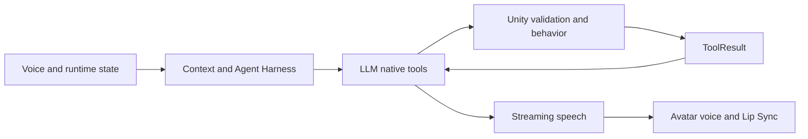

# VR Embodied AI Companion

**A state-aware embodied AI agent integrating real-time voice, native tool calling, and Unity character behavior for adaptive VR exercise research.**

[日本語](README_ja.md) · [Architecture](docs/architecture.md) · [Code guide](docs/agent-harness.md) · [Validation](docs/quest-validation-status.md)

This Unity XR prototype connects spoken dialogue to semantic character actions. The agent observes runtime state, requests an available capability, and receives a ToolResult after Unity validates and dispatches it. Voice, facial expression, gesture, Gaze and spatial behavior share an identity-aware interaction lifecycle.

The research direction is **state-dependent exercise support**, including preliminary **Visual Gain / visual speed manipulation**. Sensor-driven adaptive interventions and efficacy evaluation remain future work.

## Demo Video — Desktop runtime

[](media/VR_Embodied_AI_Companion_Demo_JA.mp4)

**66.9s · Japanese text conversation · native Lead/Wave tool-result loop · live Roxy3 streaming voice/LipSync · Side walking and Run.** New continuous Unity recording; preset text and virtual movement disclosed onscreen. Not physical ASR, exercise-sensor or Quest/HRTF validation. Preliminary Visual Gain remains a research feature and is not shown. [Technical review](media/demo-review.md) · [Evidence](docs/demo-evidence.json).

Owner-reviewed Desktop demonstration, released together with the selected source and documentation. Original project source is MIT-licensed where the owner has authority; third-party materials and rendered media retain their separate terms. [License scope](docs/LICENSE_SCOPE.md).

## Technical highlights

- **State-aware architecture** — authoritative observations, immutable snapshots and bounded context. [AgentStateStore](unity/Assets/AgentContextModule/Runtime/AgentStateStore.cs) · [ContextBuilder](backend/agent_context.py)
- **Native Tool Calling** — state-aware availability, double validation and result feedback. [Registry](backend/capabilities/registry.py) · [Unity bridge](unity/Assets/CompanionCapabilityModule/Runtime/ToolExecutionBridge.cs)
- **Realtime voice** — Japanese ASR, streaming DeepSeek/GPT-SoVITS and speech ownership. [Voice pipeline](docs/voice-pipeline.md) · [SpeechArbiter](unity/Assets/ExerciseAgent/Scripts/SpeechArbiter.cs)
- **Embodied Unity interaction** — expressions, gestures, Gaze, separate Walk/Run and spatial formation. [Behavior authority](unity/Assets/CompanionBehaviorModule/Runtime/CompanionBehaviorOrchestrator.cs)
- **Evaluation and reliability** — deterministic contracts, cancellation, history protection and bounded recovery. [Evaluation](docs/evaluation.md) · [Failure policy](docs/reliability.md)
- **VR exercise research** — initial HMD-based Visual Gain with future safety-constrained intervention selection. [Implementation](unity/Assets/Scripts/FreeWalkingSpeedGain.cs) · [Research vision](docs/research-vision.md)

## Architecture at a glance — current prototype



This is a system diagram, not a runtime screenshot. Detailed current/future boundaries are in [architecture](docs/architecture.md).

## Demo and current status


This is an independent, unofficial technical portfolio. Demo speech uses AI synthesis, not a new recording by the original performers; their participation or endorsement is not claimed. Third-party assets remain subject to their rights and terms; no character assets, voice weights or source recordings are redistributed. [AI voice notice](THIRD_PARTY_AND_AI_VOICE_NOTICE.md) · [Credits](docs/THIRD_PARTY_NOTICES.md).


**Desktop-validated prototype with partial Quest PCVR hardware validation.**

**Owner-reviewed Desktop Demo with contacted model-modifier and voice-publisher permissions confirmed for the described use.** Explore the [tool lifecycle](docs/tool-calling.md) and [real sanitized metrics](eval/evidence/pcvr-performance-2026-10-21.json) alongside the video; these are technical evidence, not footage.

Portfolio v0.1: **Source-code Showcase + Architecture Reference**, not a turnkey Unity project. [Setup boundaries](docs/setup.md) · [License decision](LICENSE_OPTIONS.md). Exact repository/release status and remote checks are recorded in the P6 publication report.

## Status: implementation is not platform acceptance

| Area | Current evidence |
|---|---|
| Context/State, evaluation, capability registry, failure/fallback | Implemented; prior development regressions passed within their recorded scopes |
| Native Tool Calling | Enabled in private prototype; tool/result loop and contract checks |
| Streaming LLM/TTS, production JA Whisper, Roxy3 | Implemented and Desktop validated; voice/model assets excluded |
| Lip Sync / 3D Voice / Gaze / Wave | Implemented; functional PCVR observations obtained |
| HMD/controller tracking, core semantic input | Quest PCVR verified |
| Moving SIDE / LEAD / TRAIL | Verified **with temporary simulated Rig movement**, not exercise sensors |
| Physical microphone first-attempt reliability | **FAIL**, missed speech and noise-trigger risks |
| Physical barge-in | **FAIL overall: 3/5 confirmed interruptions** |
| Static spatial outcomes | **PARTIAL**: Accepted Lead/Side can leave Stay with no relocation |
| PCVR frame performance | **Budget not met**; baseline collected, not acceptance |
| Android Standalone | **NOT STARTED** |
| ExerciseInput / long-term memory / proactive agent | **NOT IMPLEMENTED** |

**PCVR overall remains PARTIAL.** Packaging does not replace hardware acceptance. Streaming ASR providers remain experimental, disabled in production; experimental echo suppression/AEC is not production AEC. **Tool Accepted acknowledges dispatch, not guaranteed physical completion.**

## Read the engineering

- [Agent Harness](docs/agent-harness.md), [tool lifecycle](docs/tool-calling.md), [voice pipeline](docs/voice-pipeline.md)
- [Evaluation](docs/evaluation.md), [reliability](docs/reliability.md), [performance](docs/performance.md)
- [Research vision](docs/research-vision.md), [roadmap](docs/roadmap.md), [limitations](docs/limitations.md)
- [Release audit](docs/PUBLIC_RELEASE_AUDIT.md), [third-party notices](docs/THIRD_PARTY_NOTICES.md)
- [Project summary](portfolio/project-summary.md), [resume bullets](portfolio/resume-bullets.md)

## Performance, without hiding spikes

Latest measurement: **Windows Editor + Quest 2 Link/Air Link**, seven 45-second workloads. Combined frame p95 **27.85ms**; Conversation maximum frame **≈1014ms**; 72Hz reference budget **≈13.89ms**. GPU timing is insufficient to establish full stereo/compositor cost. No Android profiling or exercise sensor input was performed.

[Sanitized counters](eval/evidence/pcvr-performance-2026-10-21.json) preserve conditions and maxima. Private audio/conversation traces are not included. Prior medium/int8 decoding optimization is separately reported with retained-WAV conditions; unrelated benchmark numbers are not pooled.

## Source layout

```text
unity/Assets/       selected C# modules and capability manifest
backend/            selected Python application, providers and evaluation harness
eval/               sanitized aggregate evidence
docs/               architecture, validation and release boundaries
portfolio/          English / Japanese / Chinese application material
media/              owner-reviewed Desktop MP4, thumbnail and technical review
```

## Media and license scope

The owner reviewed and approved the exact Desktop Demo and the selected source for publication. Contacted model-modifier and Roxy3-publisher permissions cover the described portfolio use; the project remains independent and unofficial. Private authorization originals, character assets, voice weights and reference/training recordings are not redistributed. [Media review](media/demo-review.md) · [MIT scope](docs/LICENSE_SCOPE.md) · [Credits](docs/THIRD_PARTY_NOTICES.md).


## Reproducing safely

Start with [setup.md](docs/setup.md). Pure Python contracts are the reproducible subset. Full playback needs licensed assets, SDKs, scene wiring, a local authorized voice service and credentials. This candidate does not reconstruct that environment automatically.

Visual Gain is preliminary infrastructure, **not evidence of improved exercise performance**. Future LLM-selected interventions must be safety-constrained; the LLM must not freely alter exercise parameters. This prototype is not a medical/exercise-prescription system.

## Public test subset

Latest P6 contract run (2026-10-22 JST): **68 PASS /11 SKIP**, exit0, using unchanged assertions and authentic sanitized historical evidence. This is not full-system verification. [Exact command, prior failure and all skip reasons](docs/evaluation.md). Clean installation and the stripped Unity project's compilation remain unverified.

[Verified authorization metadata](docs/authorization-evidence.json) and [current Demo review](media/demo-review.md). Private affirmative replies are preserved without publishing screenshots; source assets/weights remain excluded.
