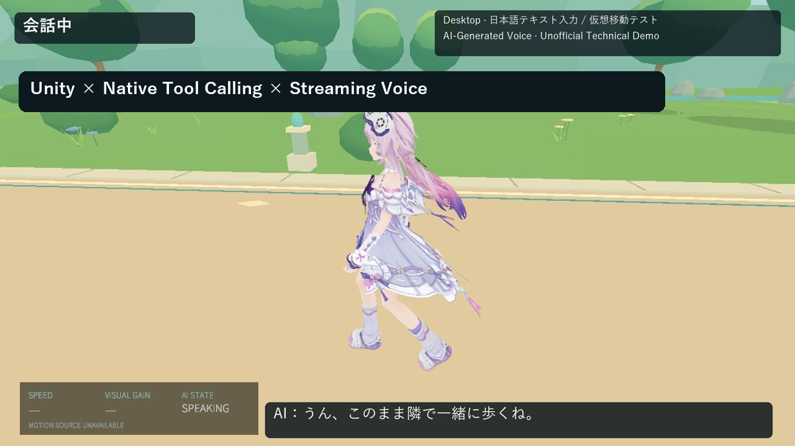
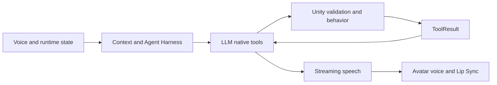

# VR Embodied AI Companion

**リアルタイム音声・Native Tool Calling・Unityキャラクター行動を統合した、VR運動研究向けの状態認識型AIエージェント。**

[English](README.md) · [構成](docs/architecture.md) · [実装ガイド](docs/agent-harness.md) · [検証](docs/quest-validation-status.md)

AIが実行時の状態を観測し、利用可能な意味的アクションを選び、Unity側の検証・行動ポリシーを通してキャラクターを動かすプロトタイプです。ToolResultをLLMへ返し、発話と実行結果を結び付けます。音声対話、表情、ジェスチャ、Gaze、空間行動を、ターン識別子を持つ共通の対話ライフサイクルで統合しています。

## デモ動画 — Desktop実行

**66.9秒・日本語テキスト会話・Native Tool Callingによる先導／Waveと結果返却・実際のRoxy3ストリーミング音声／口パク・伴走と走行。** 同一Unity Playの新規連続録画です。定型テキストと仮想移動を明示し、実マイクASR・運動センサー・Quest/HRTF検証として扱いません。予備的Visual Gainは研究機能ですが、この動画では実演していません。[技術説明](media/demo-review.md)・[記録](docs/demo-evidence.json)。

所有者が動画・出所・公開範囲を確認したDesktopデモです。選択されたコード・文書と同時公開します。権限のあるオリジナルプロジェクトソースはMIT、第三者素材と映像は別条件です。[ライセンス範囲](docs/LICENSE_SCOPE.md)。

## 技術的なポイント

- **Context / State Management**：実行時状態の観測、変更不能なSnapshot、上限付きContextBuilder。[状態実装](unity/Assets/AgentContextModule/Runtime/AgentStateStore.cs)
- **Native Tool Calling**：Capability Registry、状態に応じた利用可否、Backend/Unity二重検証、ToolResult。[呼び出しの流れ](docs/tool-calling.md)
- **Realtime Voice**：日本語ASR、Streaming DeepSeek/GPT-SoVITS、SpeechArbiter、PCM再生とキャンセル。[音声構成](docs/voice-pipeline.md)
- **Unity Embodiment**：表情、Nod/Wave、Gaze、独立したWalk/Run、Lead/Side/Trail。[行動ポリシー](unity/Assets/CompanionBehaviorModule/Runtime/CompanionBehaviorOrchestrator.cs)
- **Evaluation / Reliability**：決定的な契約テスト、履歴保護、遅延結果の破棄、限定的フォールバック。[検証](docs/evaluation.md)
- **研究基盤**：HMD移動に対する初期Visual Gainと、将来の安全制約付き支援選択。[研究計画](docs/research-vision.md)

## 現在の構成

上図は実装構成の説明であり、実行画面ではありません。詳細は[構成図](docs/architecture.md)へ。

## デモと検証状況

独立した非公式の技術作品集です。デモ音声はAI合成であり、元の音声出演者による新規収録ではありません。参加・承認・推薦は主張しません。第三者素材には各権利・利用条件が適用され、キャラクター素材、音声モデル重み、元録音は再配布しません。[三言語の説明](THIRD_PARTY_AND_AI_VOICE_NOTICE.md) · [クレジット](docs/THIRD_PARTY_NOTICES.md)。

**Desktopで検証したプロトタイプであり、Quest PCVRの実機検証は部分的です。**

**Public demo pending final asset review; contacted model-modifier and voice-publisher replies verified for the described portfolio use.** モデル改造者・音声モデル公開者の当該用途への同意は確認済みですが、背景・フォント・プライバシー等の最終確認が残るため、動画はまだ非公開です。[Tool Callingの流れ](docs/tool-calling.md)と[脱個人化した実測値](eval/evidence/pcvr-performance-2026-10-21.json)を掲載しています。図を実行映像に見せかけたり、動画リンクを作ったりはしていません。

| 区分 | 状態 |
|---|---|
| Agent Harness / Native Tool Calling | 実装済み。私有プロトタイプではNative呼び出し有効 |
| 日本語Whisper / Streaming LLM・TTS | Desktop検証済み。ASR入力はcomplete-WAV |
| Lip Sync / 3D音声 / Gaze / Wave | 実装済み。PCVRで機能確認 |
| HMD・コントローラー・基本入力・room-scale | 実機確認済み（精密なGain校正ではない） |
| 移動中Lead/Side/Trail | **仮想Rig移動**を使って確認。運動センサーではない |
| 発話開始検出 | **FAIL**：軽い声・通常音量でも初回を逃す場合あり |
| 実機での割り込み | **FAIL、5回中3回成功** |
| 静止時の位置変更 | **PARTIAL**：AcceptedでもStayのままの場合あり |
| PCVRフレーム予算 | **未達**：Combined p95 27.85ms、会話最大約1014ms |
| Android Standalone | **未着手** |

PCVR全体は**PARTIAL**です。72Hz参考予算は約13.89ms。GPU計測だけで双眼描画・合成コストを証明できず、Android計測もありません。Tool Acceptedは原則としてディスパッチ受理で、動作完了とは限りません。

Streaming ASRは実験段階・production無効、AECもproduction未導入。口パクと3D音声の機能確認は、高度なHRTF検証や完全な割り込み信頼性を意味しません。

## 研究目標と未実装の範囲

研究の方向性は、**ユーザー状態に応じてAIが適切な運動支援を選ぶこと**です。Visual Gain / 視覚速度操作（速度知覚の操作）を削除せず、発話・ジェスチャ・表情・空間行動との組み合わせを検討します。

**現在**：Embodied Agent、Agent Harness、Realtime Voice、意味的なGesture/Spatial tools、初期Visual Gain。

**将来**：Power/Cadence/Heart Rate/RPEなどのExerciseInput、Adaptive Exercise Policy、制御されたVisual Gain Tool、Intervention–Response Analysis、個別化された支援選択。長期記憶・自発行動・Wattbike・統一Locomotionも未実装です。

Observe → Decide → Act → Evaluate → Adaptを目指しますが、LLMが無制限にGainや運動パラメータを変更してよい設計ではありません。決定的な安全ポリシーが必要です。Visual Gainの運動効果を実証した成果ではありません。

## コードと実行条件

これはローカルの**Source-code Showcase + Architecture Reference**で、すぐ起動できるUnityプロジェクトではありません。70本のC#、58本のPythonアプリケーション/評価コードを選択収録し、Scene・SDK本体・第三者素材・モデル・参照音声・会話/マイク録音を除外しています。

[Backend](backend/README.md) · [Unity](unity/README.md) · [Evaluation](eval/README.md) · [セットアップ](docs/setup.md)

公開版のPure Python契約テストと、私有環境のLive/Unity/Questテストは別です。計測証拠のないテストはSKIPとなり、全システムの成功を意味しません。最新件数は[評価結果](docs/evaluation.md)に記載しています。

Unityには元のScene接続、SDK、利用許可のある素材が必要です。公開版のUnityコンパイル・Play、依存関係のクリーンインストールは未検証。所有者確認済みのMITは権限のあるオリジナルソースのみに適用します。[制約](docs/limitations.md) · [権利確認](LICENSE_OPTIONS.md)

[P4許諾記録・デモ審査](PORTFOLIO_P4_FINAL_REVIEW.md)。肯定的な私信は画像を公開せず記録し、素材・モデル重みは引き続き除外しています。

## 公開メディアとライセンス

所有者が正確な動画・ソース範囲を確認して公開を承認しました。コードは[限定されたMIT範囲](docs/LICENSE_SCOPE.md)、描画された第三者素材は独立した条件です。私信原本、モデル、重み、参照音声・訓練データは配布していません。[Credits](docs/THIRD_PARTY_NOTICES.md)。
