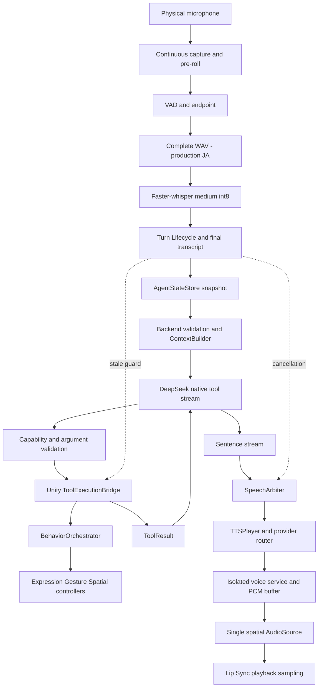

# Architecture — implemented paths

The public tree selects application sources, not the private Scene. Module names and cross-references are retained; packages/assets must be acquired separately.

| Responsibility | Source |
|---|---|
| Snapshot | unity/Assets/AgentContextModule/Runtime/AgentStateStore.cs |
| State/context | backend/agent_state.py, backend/agent_context.py |
| Capability schemas | backend/capabilities/capability_manifest.json and Unity Resources mirror |
| Native tool/result | backend/native_tools.py, backend/action_tool_policy.py, ToolExecutionBridge.cs |
| Body authority | CompanionBehaviorOrchestrator.cs |
| Speech ownership | PythonExerciseAgent.cs, SpeechArbiter.cs, TurnLifecycleManager.cs |
| Streaming | backend/agent_streaming.py, backend/tts_stream_endpoint.py, StreamingTtsSession.cs |
| Motion/spatial | CompanionFollowModule, AvatarMotionModule |
| Visual Gain | unity/Assets/Scripts/FreeWalkingSpeedGain.cs |

Preliminary Gain measures horizontal HMD displacement and applies additional XR-origin translation. It is not bike speed/power/cadence or a unified locomotion source. Snapshots observe authoritative modules rather than command them.

No original Scene, controller asset, PMX, clip, SDK source or generated model is included. Whole Unity compilation is **NOT TESTED in the stripped tree**. Backend server.py loads Whisper on import: syntax/AST tests do not imply a live service.

## Reading the diagrams

[README overview](../README.md#architecture-at-a-glance--current-prototype) is the short current-system view. Detailed [native lifecycle](tool-calling.md), [voice](voice-pipeline.md) and [evaluation/recovery](reliability.md) describe implemented paths. [Adaptive exercise](research-vision.md) is Future/Proposed. All diagrams are explanatory, not runtime images. Local Mermaid package/CLI was unavailable; structural checks do not establish actual rendering. **Render NOT VERIFIED**.
