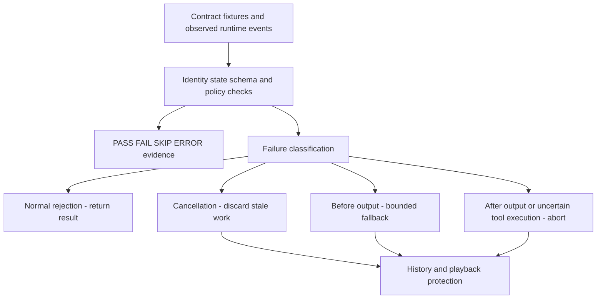

# Reliability

## Current evaluation and recovery overview

This depicts existing validation/recovery paths. Contract checks and historical measurement replay are not new live-provider or Quest tests.

Backend reliability.py and Unity ReliabilityPolicy.cs classify failures without redesigning Persona/body policy. Cancellation takes precedence. Fallback graph is bounded/cycle-checked; retry budget is explicit.

| Condition | Handling |
|---|---|
| Invalid snapshot | Minimal context; speech-only degradation for that Turn |
| Native failure before output/tool request | Bounded legacy recovery |
| LLM stream failure before output | Complete Agent fallback |
| Failure after output | Abort, no whole-answer replay |
| TTS failure before playback | Complete /tts recovery |
| Partly played audio | Stop/abort, no duplicate replay |
| GPT-SoVITS unavailable | Existing router owns Edge fallback |
| Busy/cooldown/already-in-state | Normal semantic result |
| Tool timeout | Execution unknown; no blind action replay |
| Cancelled/late result | Discard; no stale history commit |

Completed history commits once; cancelled pending replies do not become completed dialogue. This is in-process lifecycle protection, not durable transactions or long-term memory. Already-sent provider side effects cannot be physically undone by a client cancellation.

Default-OFF asr_input_guard.py is a small-corpus experiment for low-confidence/no-speech-only decoded segments; it has **not** solved physical speech/noise distinction or been promoted.

No authentication/TLS public-hosting boundary is established. Keep prototype services local, credentials Backend-only. Do not expose ports publicly.
