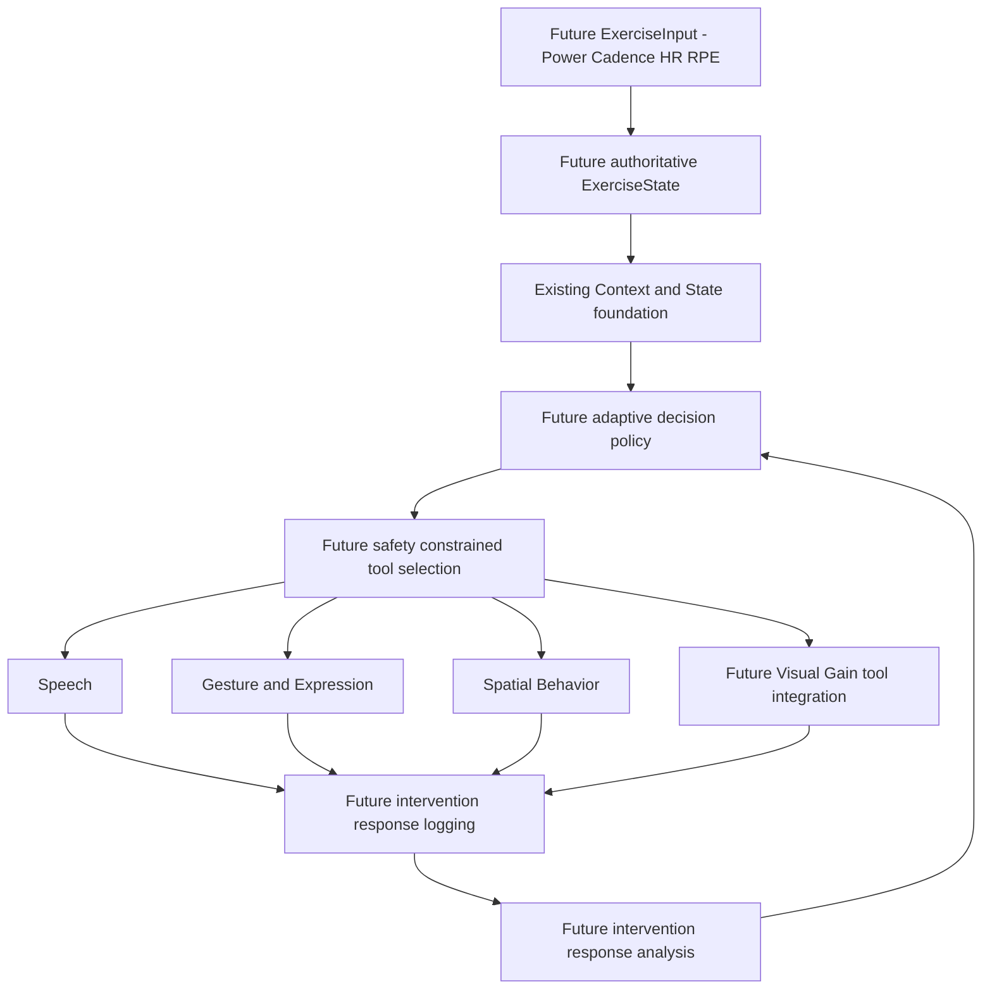

# Future / Proposed — adaptive exercise support

Existing: preliminary **Visual Gain / Visual Speed Manipulation**, embodied conversation and an Agent Harness. The goal is not simply speed deception: it is choosing appropriate support from user state and evaluating the response.

**Planned:** ExerciseInput/Wattbike, adaptive intervention selection, bounded Visual Gain capability, intervention–response logging/evaluation/adaptation. Current Inspector fields are not real power/cadence/HR sensing. Long-term memory/proactive behavior are not implemented.

LLM proposals must pass safety policy. The LLM must not freely change gain or exercise parameters. Sensor quality, safe bounds, contraindications, human oversight and stop mechanisms need separate validation.

No engineering result proves improved exercise performance. Efficacy requires a separate research protocol, appropriate consent/ethics, data collection and analysis.

## Future decision loop

Observe → Decide → Act → Evaluate → Adapt. Inputs would combine Power, Cadence, Heart Rate, RPE, Movement State and Conversation Context. A future Adaptive Exercise Policy may select Speech, Gesture, Facial Expression, Spatial Behavior, Visual Gain or approved combinations. Personalized Intervention Selection, Visual Gain as a controlled Tool and Intervention–Response Analysis are planned. Deterministic safety policy constrains all parameter changes.
