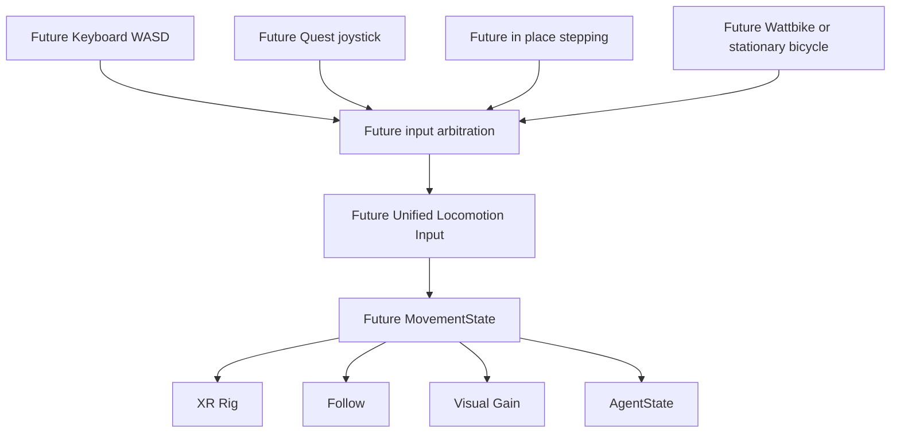

# Roadmap — no implementation in packaging

- Quest voice-start reliability, physical barge-in, ASR accuracy improvement.
- Further response latency reduction; PCVR frame spikes; later PCVR/Android performance.
- Static spatial outcomes, Lead→Trail orientation, Gesture/Speech synchronization.
- Quest button ergonomics, VR HUD, screenshot/recording workflow, Wave naturalness, ponytail physics at idle, 3D spatial transition smoothing.
- Unified Locomotion, ExerciseInput/Wattbike, adaptive intervention selection/evaluation.
- General Companion extension, long-term memory, proactive agent.

## Proposed Unified Locomotion

Existing semantic buttons are **not** this abstraction. Desktop debug/temporary Rig motion is not production exercise input. Concurrent inputs need ownership/priority/validity/transition arbitration, not simple addition of speeds. None of these new inputs is implemented here.
