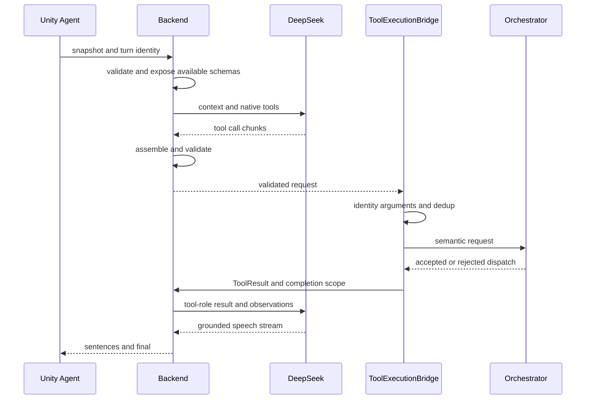

# Native tool lifecycle

The canonical manifest mirrors byte-for-byte into Unity Resources. Provider-compatible aliases preserve internal names. PendingToolResults binds responses to active identity; call IDs enforce once-only dispatch. Timeout means execution unknown, not permission to blindly repeat a body action.

Selection uses a narrow explicit-intent tool-choice policy and grounding instructions; it is not unconstrained model choice. Body authority remains the Orchestrator. Speech should describe only what results establish. Stationary promise/outcome mismatches remain open.

agent_streaming.install/native_tools.install connect channels; result feedback uses /agent/tool-result. Read source for limits. Legacy behavior envelopes remain compatible, but native requests must not execute twice via legacy and native paths.
